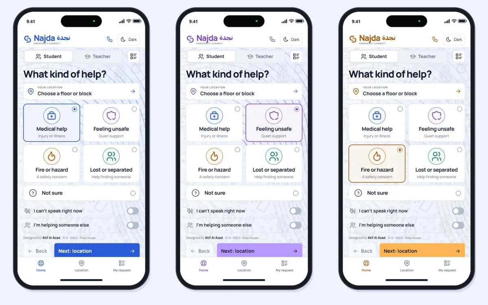

# Najda | نجدة

**Emergency Connect. A clear way to ask for help at school.**

An original UI/UX design by **Atif Al Azad · XI-D · 10673 · Rose House**.

**[Open the app →](https://atifalazad.github.io/relay-emergency-connect/?screen=home)** · [Interface PDF](submission/NAJDA-submission.pdf) · [Statement](submission/NAJDA-statement.pdf) · [Screen exports](submission/NAJDA-screen-exports.zip)

Open Najda on a phone or computer. It runs in the browser without a download or account.



## Request help in four screens

| Screen | What the student does |
| :--- | :--- |
| **1 · Help** | Choose Medical, Feeling unsafe, Fire or hazard, Lost or separated, or Not sure. Medical is selected by default. |
| **2 · Location** | Select a floor using large buttons. Add a block or nearby detail if known. Location is also one tap from the opening screen. |
| **3 · Review** | Check the request and location, then send. Back and Next controls keep the route clear. |
| **4 · Response** | See delivery, the follow-up countdown and adult arrival as separate states. Contact the duty team or report that help is still needed. |

The teacher perspective shows the same request in a shared duty inbox. The optional interactive campus model provides exterior context; it is an approximate layout, not a verified indoor map.

## Designed around the student

- **Clear status:** an unanswered request opens a visible office follow-up screen after 30 seconds in the demonstration.
- **Explicit handover:** “No, I still need help” keeps the request and location active. A request closes only after the student confirms that a responsible adult is present.
- **Quiet contact:** students can ask for text replies. Ping is labelled as an in-app notification.
- **Readable controls:** large help icons, floor choices and navigation, with light and dark themes and visible keyboard focus.
- **A consistent visual cue:** the bilingual wordmark, connection symbol and flowing wave highlights follow the selected help type. Text and icons identify the category too.
- **Motion control:** the wave effect can be paused and respects reduced-motion preferences.

## Submission

| File | Contents | Size |
| :--- | :--- | ---: |
| [Interface PDF](submission/NAJDA-submission.pdf) | 8 pages covering the main journey, teacher view and follow-up states | 1.40 MB |
| [Statement PDF](submission/NAJDA-statement.pdf) | Separate one-page design explanation | 43 KB |
| [Statement text](submission/NAJDA-statement.txt) | Plain text explanation | 1 KB |
| [PNG exports](submission/NAJDA-screen-exports.zip) | 16 mobile screen exports | 5.57 MB |

Phone mockups include a presentation status bar and Dynamic Island. The green dot is part of the mockup; it does not indicate camera or microphone use.

## What the prototype demonstrates

Requests, staff replies, pings and office escalation are simulated within the browser session. No real school alert service is connected. The duty teacher is a generic role; no personal teacher name or phone number is included. Staff positions are not tracked. Call buttons open the device dialler.

After a successful first load, the hosted app can cache its interface for reopening offline. It does not send an emergency request offline. The 30-second escalation threshold illustrates the proposed interaction and would require agreement with the school before real deployment.

Responsive checks covered desktop and phone-sized browser viewports. Physical iPhone installation has not been tested.

## Work with the source

The editable React and Three.js code is in [`app/`](app/). Node.js 22 or later and npm are required.

```sh
cd app
npm install
npm test
npm run build
npm run dev
```

Open `http://127.0.0.1:4173`. The build writes to `app/dist/`; the local server serves that folder.

`npm test` checks the escalation timer boundary, offline failure, retained location, no-adult follow-up and explicit handover confirmation.

```text
app/          Editable source, assets and local build tools
docs/         Current mobile preview
licenses/     Third-party licence notices
submission/   Current PDFs, statement and PNG exports
index.html    Published, self-contained app
sw.js         Hosted app cache
```

The root `index.html` is the packaged website. It is kept separate from the editable source so the existing GitHub Pages link stays usable. To refresh it after source changes, run `npm run package` from `app/`, then publish the updated root files. The repository retains its original URL for existing bookmarks.

## Assets and attribution

Najda uses an original layout, bilingual wordmark and connection symbol. No school crest is included. The monochrome school doodles were generated with the built-in image tool; the asset description is in [`asset-notes.txt`](asset-notes.txt). They do not depict verified school architecture.

Manrope, Tabler icons, React, React DOM and Three.js retain their respective notices in [`licenses/`](licenses/). Those notices cover the third-party assets and libraries, not a blanket licence for the entire project.
